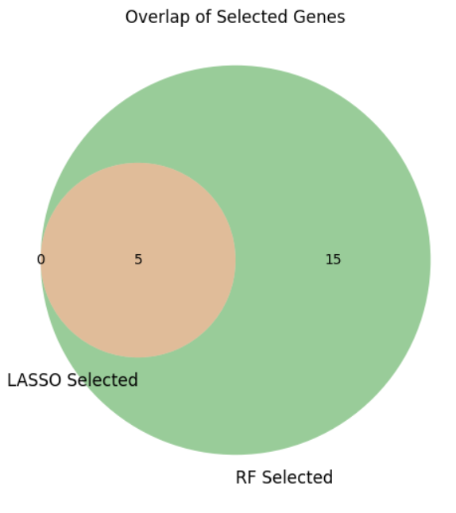

# Lung Cancer Biomarker Discovery

**Integrating gene-expression analysis, interaction networks, and machine learning to prioritize candidate biomarkers for non-small cell lung cancer.**

[Methods](docs/METHODS.md) · [Results](docs/RESULTS.md) · [Data sources](docs/DATA.md) · [References and credits](docs/REFERENCES.md)

## Overview

This 2025 research project investigated molecular differences between lung tumor and non-tumor tissues using public GEO gene-expression datasets. Differential expression, functional enrichment, protein–protein interaction analysis, and machine learning were combined to identify candidates for further biological investigation.

**Project lead:** [Jamyang Ugyen Tshomo](https://github.com/JamyangUT). I led the project from planning through analysis, interpretation, and reporting, working with Rainy Varshney and Sujitha Rajkumar under the supervision of Dr. Utkarsh Raj and Ms. Shivani Varshney at NIIT University.

## Research workflow

1. Review the literature and identify relevant lung cancer expression datasets in GEO.
2. Perform differential expression analysis using GEO2R and R/limma.
3. Filter and compare gene lists, and investigate Gene Ontology and KEGG enrichment.
4. Build interaction networks with STRING; identify densely connected clusters with Cytoscape and MCODE.
5. Map selected genes to expression features and apply LASSO, Random Forest, SVM, and Decision Tree approaches in R and Python.
6. Compare selected features and interpret their biological relevance.

## Main findings

- **TOP2A, PRC1, and MCM4** were highlighted as candidate biomarkers in the study manuscript.
- Enrichment analyses highlighted **extracellular matrix organization, angiogenesis, and wound healing**, alongside pathways relevant to cell adhesion, cytoskeletal organization, and tumor biology.
- Comparing LASSO and Random Forest selections yielded five overlapping expression features in the reported analysis.



*Original project-report figure: five features overlap between the two selections. This is agreement between feature-selection methods on the study data, rather than independent biological validation.*

## Tools

**R · Python · GEO2R · limma · STRING · Cytoscape · MCODE · LASSO · Random Forest · SVM · Decision Trees · GO · KEGG**

## Research status and limitations

This repository is a **documented research showcase**. The analysis was completed for the project report and manuscript; the original code, fitted models, and processed analysis matrices are unavailable and are not included. The methods and figures document the original study and are not a newly executed pipeline.

The candidate biomarkers require independent-cohort and experimental validation. The source documents also leave uncertainty about the exact discovery-cohort membership and expression harmonization across platforms. [Methods](docs/METHODS.md) and [data notes](docs/DATA.md) describe those limits.

## Related manuscript

**[Integrative Bioinformatics and ML Strategy for Identifying Lung Cancer Biomarkers](https://doi.org/10.1109/ICRITO66076.2025.11241354)** — Jamyang Ugyen Tshomo, Sujitha Rajkumar, Rainy Varshney, Shivani Varshney, and Utkarsh Raj. Published in the proceedings of **ICRITO 2025**, IEEE. Jamyang is the first author in the publisher-deposited Crossref record.

## Repository contents

```text
README.md             Project overview, contribution, and main findings
docs/METHODS.md       Documented workflow and reproducibility boundaries
docs/RESULTS.md       Reported findings and held-out confusion matrix
docs/DATA.md          Referenced GEO accessions and verified assay metadata
docs/REFERENCES.md    Source documents, scientific references, and credits
figures/             Selected figures extracted from the original group report
```
