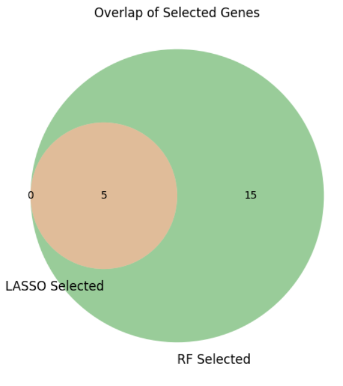
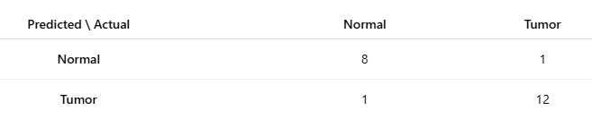

# Reported Results

The findings below come from the original study documents and figures. They have not been recomputed from the source data.

## Expression and network findings

The documents report 859 filtered DEG entries and 215 common genes from the discovery analysis. Since the original merged tables and cohort membership are unavailable, the reported entry count cannot be independently checked for unique-gene counting or cross-dataset duplication.

The manuscript highlights **TOP2A, PRC1, and MCM4** as candidate biomarkers. Its network and feature-selection sections also discuss genes involved in cell-cycle and mitotic processes, including TYMS, BIRC5, CCNB2, and AURKA. Individual gene rankings differ across methods and expression features.

GO enrichment highlighted extracellular matrix organization, angiogenesis, and wound healing. KEGG analyses discussed cytoskeletal organization, complement/coagulation, p53 signaling, ECM-receptor interaction, focal adhesion, HIF-1 signaling, and AGE-RAGE signaling.

These are computational associations. They do not establish causal mechanisms, diagnostic readiness, or new clinical indications.

## Feature-selection agreement

The original Venn diagram shows **5 overlapping features**, **15 additional Random Forest features**, and **0 LASSO-only features**. This corresponds to 20 Random Forest-selected features and 5 LASSO-selected features. Some prose in the group report describes the Random Forest total differently; the figure is reproduced without changing it.

Feature identifiers can include multiple probes for the same gene, so feature counts should not automatically be interpreted as distinct gene counts.

## Reported SVM test result

The original figure is labeled **Predicted \ Actual**:

| Predicted class | Actual normal | Actual tumor |
| --- | ---: | ---: |
| Normal | 8 | 1 |
| Tumor | 1 | 12 |

It contains **22 test samples**, with **20 correct classifications**, giving **20/22 = 90.91%** accuracy. This explains the percentage reported in the documents. Their wording “91 out of 100” is an approximation, not the actual test-set count.

This small reported test result is not an independently reproduced or externally validated estimate. The source documents do not establish sample independence or the timing of feature selection relative to splitting.

## Other performance statements

The report and manuscript state a Random Forest ROC-AUC of 1.0. The original model, prediction scores, split identifiers, and evaluation code are unavailable, so this value is not promoted as independently verified performance.

Decision Tree terminal-node class probabilities are described as 94% and 93% in the group report. They should not be presented as an overall held-out accuracy estimate.

## Next validation steps

- Recover or reconstruct cohort and sample provenance.
- Check expression-platform processing and batch effects.
- Perform feature selection and tuning within training folds.
- Evaluate a locked model on independent cohorts.
- Test the biological relevance of shortlisted candidates experimentally.
